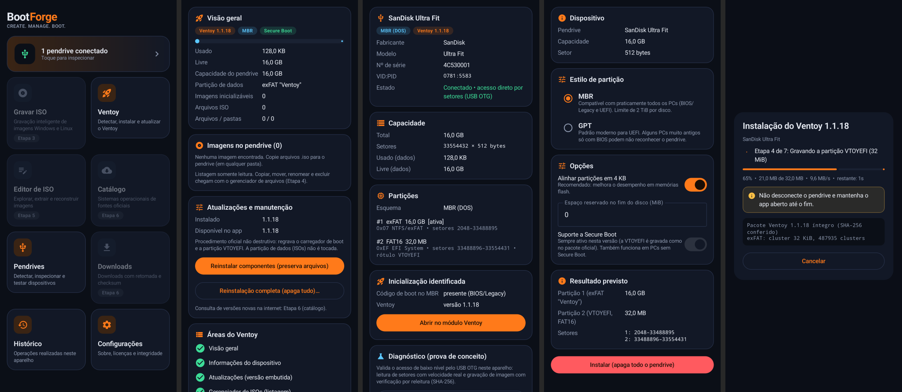
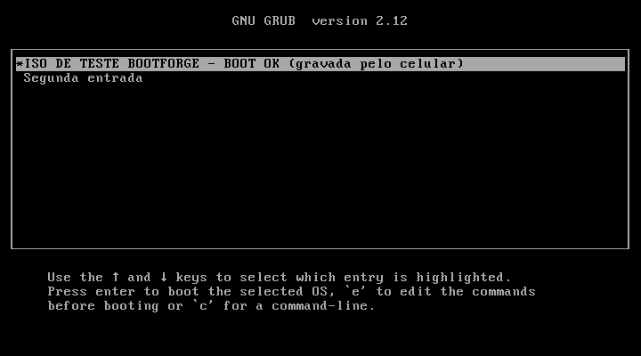
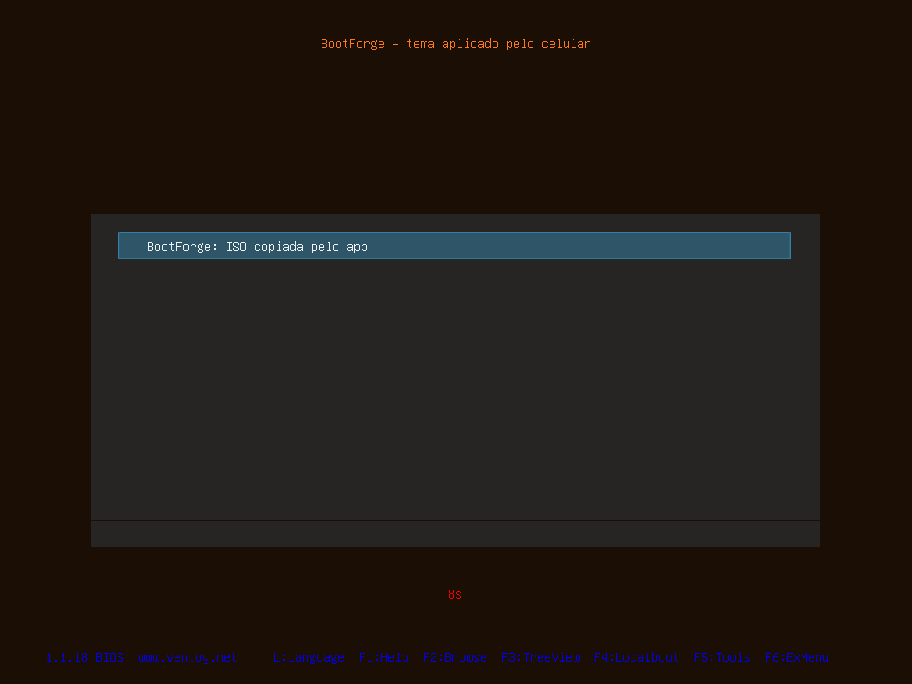
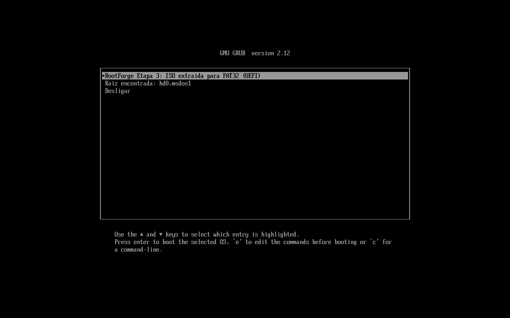
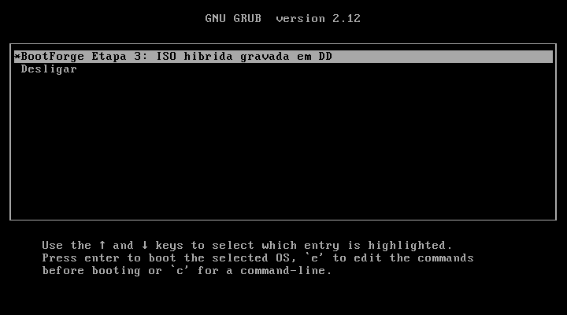
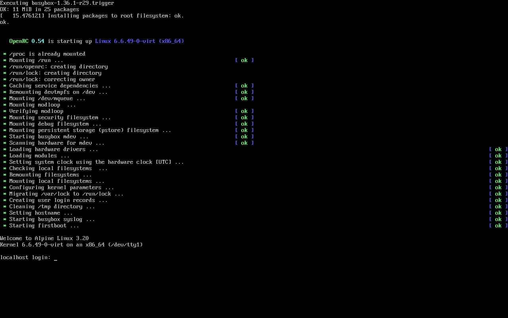
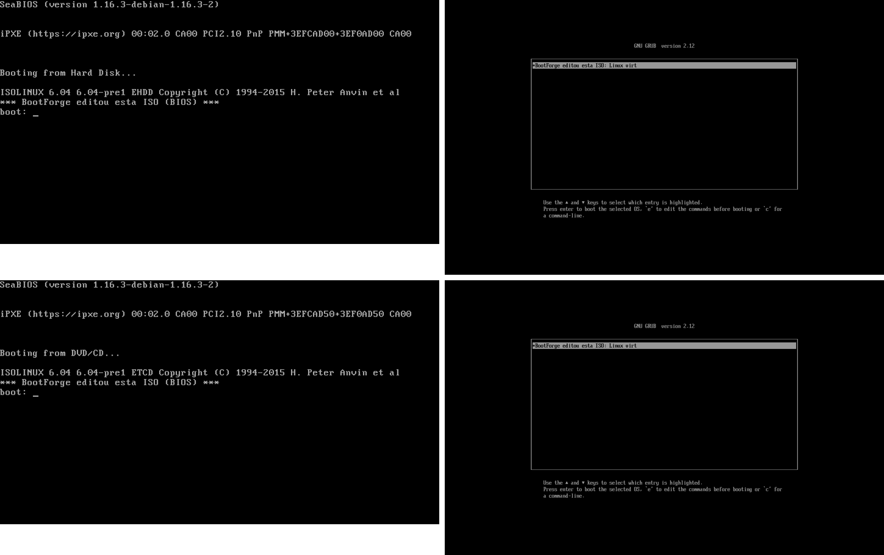

# BootForge

**CREATE. MANAGE. BOOT.** — *Universal Bootable Media Manager*

Aplicativo Android para preparar e gerenciar pendrives inicializáveis **diretamente pelo celular,
via USB OTG, sem root e sem computador**.



> **Estado atual: 0.6.0 — as 7 etapas implementadas; falta o teste em celulares e pendrives reais para a 1.0.**
> Tudo validado em discos virtuais com boot real no QEMU (BIOS e UEFI) e comparado com as
> ferramentas oficiais do Ventoy. **Ainda não testado em celular real** — veja o
> [roteiro de testes](docs/ROTEIRO-TESTES-REAIS.md). Status completo em
> [docs/ACOMPANHAMENTO.md](docs/ACOMPANHAMENTO.md).

## O que já funciona

- 🔌 Detecção de pendrives por USB OTG, pedido de permissão e acesso **setor a setor** (sem root).
- 🔎 Leitura de MBR/GPT, partições, sistemas de arquivos e setor 0.
- 💽 **Gravar ISO** com análise automática: ISO híbrida (Linux) em **DD**; **instalador do Windows**
  em FAT32 com o `install.wim` > 4 GB dividido em `.swm` (método oficial da Microsoft); outras ISOs
  UEFI extraídas para FAT32; MBR ou GPT; verificação SHA-256 por releitura. O app explica por que
  cada método está disponível ou não.
- ✏️ **Editor de ISO** não destrutivo: explorar, pesquisar, ver/editar textos (ex.: `grub.cfg`),
  adicionar, substituir, renomear, mover e excluir, com desfazer/refazer. Gera uma **nova** ISO em
  dois modos — *Preservar inicialização* (mantém El Torito, MBR/GPT híbridos e carregadores no lugar)
  ou *Reconstrução completa* (ISO9660 + Joliet + Rock Ridge + **UDF** para o Windows) — e valida a
  ISO gerada relendo tudo. Também extrai arquivos e pastas.
- 🌐 **Catálogo e downloads** de fontes oficiais (Ubuntu, Linux Mint, Debian, Fedora, Zorin, Pop!_OS,
  Alpine, Ventoy; Windows pelo site da Microsoft): versão mais recente consultada nas APIs/feeds
  oficiais, **assinaturas OpenPGP verificadas** (Ubuntu, Debian, Mint), downloads com pausa e
  retomada, verificação do checksum e biblioteca para gravar, copiar para o Ventoy ou editar.
  Detalhes em [docs/04-fontes-oficiais.md](docs/04-fontes-oficiais.md).
- 🚀 **Ventoy 1.1.18**: detecção automática (mesmas regras do oficial), instalação real (MBR ou GPT,
  alinhamento 4K, espaço reservado, Secure Boot) e atualização **sem apagar as ISOs**.
- 🗂️ **Gerenciador de arquivos** da partição do Ventoy: copiar do/para o celular, mover, renomear,
  excluir, pastas, pesquisar, compartilhar, propriedades, espaço por tipo e duplicados.
- 💿 **Gerenciador de ISOs**: mostra o que aparece no menu do Ventoy (e por quê), identifica o sistema
  (Ubuntu, Windows, Mint…), boot BIOS/UEFI, integridade por SHA-256, organização por pastas.
- ⚙️ **ventoy.json**: editor visual (15 plugins e 25 opções oficiais), editor avançado com validação,
  backups automáticos.
- 🎨 **Temas**: tema original, importar .zip, aplicar, remover, trocar imagens, pré-visualização.
- 🧰 **Ferramentas**: verificar instalação, Secure Boot liga/desliga, backup/restauração, persistência.
- ⬆️ **Atualizações** do GitHub oficial com conferência de SHA-256 (sem apagar as ISOs).
- 🔔 Operações longas em segundo plano com notificação de progresso.
- 🪲 **Logs e diagnóstico**: log contínuo, relatório de travamentos e botão *Enviar log do erro* —
  o relatório (.txt) pode ser compartilhado pelo WhatsApp ou e-mail. Veja [docs/05-testes-e-estabilidade.md](docs/05-testes-e-estabilidade.md).
- 🧪 Diagnóstico: teste de velocidade de leitura e gravação RAW de imagem com verificação SHA-256.
- 🛡️ Confirmações fortes (digitar `APAGAR`, conferência quando há vários pendrives) e progresso real.
- 📜 Histórico local de operações.

Módulos ainda não implementados aparecem **bloqueados** na tela inicial com a etapa prevista.

| Validação no QEMU | |
|---|---|
|  |  |
| Apelido e contagem gravados pelo app no `ventoy.json` | A ISO copiada pelo app dando boot |
|  |  |
| Tema aplicado pelo app | GPT + UEFI |
|  |  |
| Etapa 3: ISO extraída para FAT32 dando boot em UEFI | Etapa 3: ISO híbrida gravada em DD (BIOS) |
|  |  |
| Etapa 5: ISO real do Alpine editada pelo app, iniciando até o login | Etapa 5: a mesma ISO editada em pendrive e CD, BIOS e UEFI |

## Estrutura de pastas

```
BootForge/
├── app/                    Aplicativo Android (telas em Jetpack Compose)
│   └── src/main/kotlin/dev/bootforge/app/
│       ├── MainActivity.kt         navegação entre telas
│       ├── ui/AppViewModel.kt      operações (instalar, atualizar, gravar, inspecionar)
│       ├── ui/screens/             telas
│       ├── ui/components/          cartões, diálogos, selos
│       ├── ui/theme/Theme.kt       CORES e fontes do app
│       └── data/                   histórico e formatação
├── android/usb/            Acesso ao pendrive pelo USB OTG
├── core/                   Núcleo em Kotlin puro (roda no celular e no PC)
│   ├── blockdev/           "dispositivo de setores", cópia com progresso e hash
│   ├── partition/          MBR, GPT, identificação de sistemas de arquivos
│   ├── fs-fat/             FAT: leitor, escrita mínima e gerador FAT32
│   ├── wim/                divisão do install.wim em .swm
│   ├── fs-exfat/           exFAT: formatar, ler, gravar, verificar
│   ├── fs-ext/             ext2/ext3 (persistência)
│   ├── iso/                ISO9660/Joliet/Rock Ridge/El Torito/UDF + identificação
│   └── integrity/          SHA-256/512
├── feature/iso-writer/     Etapa 3: análise da ISO e gravação (DD, Windows FAT32, extração)
├── feature/iso-editor/     Etapa 5: edição não destrutiva, reconstrução (ISO9660/Joliet/RR/UDF) e validação
├── feature/catalog/        Etapa 6: catálogo (catalog.json), fontes oficiais, assinaturas, downloads, biblioteca
├── feature/ventoy-core/    instalar, detectar, atualizar, catálogo, temas, ferramentas, download
├── feature/ventoy-config/  ventoy.json: esquema oficial, validação, edição
├── tools/cli/              ferramenta de linha de comando (testes com arquivos .img)
├── third_party/            pacote ORIGINAL do Ventoy 1.1.18 + licenças
└── docs/                   relatório técnico, análise do Ventoy, arquitetura, acompanhamento
```

## Como compilar (notebook Windows 11)

1. Instale o **Android Studio** (ele já traz o JDK e o Android SDK).
2. Abra a pasta `BootForge` no Android Studio (*File → Open*). Aguarde o "Gradle Sync".
3. Conecte o celular com **Depuração USB** ativada e clique em ▶️ *Run*.
   - Ou gere o APK: menu *Build → Build App Bundle(s)/APK(s) → Build APK(s)*.
   - Pelo terminal: `gradlew.bat :app:assembleRelease` → `app\build\outputs\apk\release\app-release.apk`.

> O APK "release" é assinado com a chave de **debug** apenas para testes. Para publicar na Play Store
> será preciso criar uma chave própria.

### Testes automatizados

```bash
./gradlew test                         # testes do núcleo (usa os arquivos reais do Ventoy)
./gradlew :app:verifyPaparazziDebug    # confere as telas contra as capturas salvas
./gradlew :app:recordPaparazziDebug    # regrava as capturas (após mudar o visual)
```

### Ferramenta de linha de comando (PC)

Testa o mesmo núcleo do app em **arquivos de imagem** (nunca em discos reais):

```bash
./gradlew :tools:cli:installDist
CLI=tools/cli/build/install/bootforge-cli/bin/bootforge-cli   # no Windows: bootforge-cli.bat
$CLI create  teste.img 8G
$CLI install teste.img --gpt
$CLI inspect teste.img
$CLI update  teste.img
$CLI put     teste.img minha.iso /Linux/minha.iso     # copia arquivos para o pendrive virtual
$CLI catalog teste.img                                # o que aparece no menu do Ventoy
$CLI check   teste.img                                # verificar instalação
$CLI secureboot teste.img off                         # e mais: json, control, theme, persist, isoinfo
$CLI iso-analyze minha.iso                            # Etapa 3: qual método usar e por quê
$CLI iso-write   minha.iso teste.img [--gpt]           # grava a ISO no pendrive virtual
$CLI iso-info    minha.iso                            # Etapa 5: formato, boot e modos de reconstrução
$CLI catalog                                          # Etapa 6: versões atuais nas fontes oficiais
$CLI catalog-download debian-netinst ./isos            # baixa/continua e verifica a assinatura
$CLI iso-rebuild minha.iso nova.iso --text /boot/grub/grub.cfg=meu.cfg --mkdir /extras
```

Para testar o boot no Linux: `tools/scripts/qemu-screenshot.sh teste.img uefi tela.ppm`.

## Como personalizar

| Quero mudar… | Onde |
|---|---|
| Cores do app | `app/src/main/kotlin/dev/bootforge/app/ui/theme/Theme.kt` → objeto `BfColors` |
| Textos e descrições dos módulos da tela inicial | `ui/screens/HomeScreen.kt` → lista `modules` |
| Nome do app | `app/src/main/res/values/strings.xml` |
| Ícone | `app/src/main/res/drawable/ic_launcher_foreground.xml` |
| Versão do app | `app/build.gradle.kts` → `versionName` |
| Versão do Ventoy embutida | substituir `third_party/ventoy-X` e cadastrar os SHA-256 em `VentoyPackage.KNOWN_SHA256` |

## Licença

**GNU GPL v3** — ver [LICENSE](LICENSE). O BootForge embute componentes do
[Ventoy](https://www.ventoy.net/) (GPLv3) sem modificação. Demais licenças em
[THIRD_PARTY_LICENSES.md](THIRD_PARTY_LICENSES.md).
