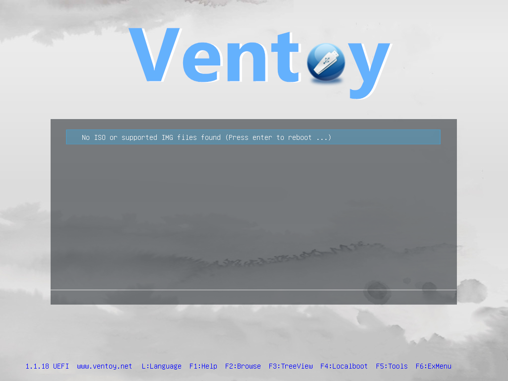

# BootForge

**CREATE. MANAGE. BOOT.** — *Universal Bootable Media Manager*

Aplicativo Android para preparar e gerenciar pendrives inicializáveis **diretamente pelo celular,
via USB OTG, sem root e sem computador**.


> **Estado atual: 0.1.0-poc (Etapas 1 e 2 + núcleo do Ventoy).**
> Instalação, detecção e atualização do Ventoy funcionam e foram validadas em discos virtuais com
> boot real (QEMU, BIOS e UEFI). **Ainda não testado em celular real** — veja o
> [roteiro de testes](docs/ROTEIRO-TESTES-REAIS.md). Status completo em
> [docs/ACOMPANHAMENTO.md](docs/ACOMPANHAMENTO.md).

## O que já funciona

- 🔌 Detecção de pendrives por USB OTG, pedido de permissão e acesso **setor a setor** (sem root).
- 🔎 Leitura de MBR/GPT, partições, sistemas de arquivos e setor 0.
- 🚀 **Ventoy 1.1.18**: detecção automática (mesmas regras do oficial), instalação real (MBR ou GPT,
  alinhamento 4K, espaço reservado, Secure Boot) e atualização **sem apagar as ISOs**.
- 💿 Lista das ISOs/imagens existentes no pendrive Ventoy, espaço usado/livre.
- 🧪 Diagnóstico: teste de velocidade de leitura e gravação RAW de imagem com verificação SHA-256.
- 🛡️ Confirmações fortes (digitar `APAGAR`, conferência quando há vários pendrives) e progresso real.
- 📜 Histórico local de operações.

Módulos ainda não implementados aparecem **bloqueados** na tela inicial com a etapa prevista.

| Validação do instalador | |
|---|---|
|  |  |
| MBR + BIOS, com ISOs em subpastas | GPT + UEFI |

## Estrutura de pastas

```
BootForge/
├── app/                    Aplicativo Android (telas em Jetpack Compose)
│   └── src/main/kotlin/dev/bootforge/app/
│       ├── MainActivity.kt         navegação entre telas
│       ├── ui/AppViewModel.kt      operações (instalar, atualizar, gravar, inspecionar)
│       ├── ui/screens/             telas
│       ├── ui/components/          cartões, diálogos, selos
│       ├── ui/theme/Theme.kt       CORES e fontes do app
│       └── data/                   histórico e formatação
├── android/usb/            Acesso ao pendrive pelo USB OTG
├── core/                   Núcleo em Kotlin puro (roda no celular e no PC)
│   ├── blockdev/           "dispositivo de setores", cópia com progresso e hash
│   ├── partition/          MBR, GPT, identificação de sistemas de arquivos
│   ├── fs-fat/             leitor FAT
│   ├── fs-exfat/           formatador e leitor exFAT
│   └── integrity/          SHA-256/512
├── feature/ventoy-core/    detecção, instalação e atualização do Ventoy
├── tools/cli/              ferramenta de linha de comando (testes com arquivos .img)
├── third_party/            pacote ORIGINAL do Ventoy 1.1.18 + licenças
└── docs/                   relatório técnico, análise do Ventoy, arquitetura, acompanhamento
```

## Como compilar (notebook Windows 11)

1. Instale o **Android Studio** (ele já traz o JDK e o Android SDK).
2. Abra a pasta `BootForge` no Android Studio (*File → Open*). Aguarde o "Gradle Sync".
3. Conecte o celular com **Depuração USB** ativada e clique em ▶️ *Run*.
   - Ou gere o APK: menu *Build → Build App Bundle(s)/APK(s) → Build APK(s)*.
   - Pelo terminal: `gradlew.bat :app:assembleRelease` → `app\build\outputs\apk\release\app-release.apk`.

> O APK "release" é assinado com a chave de **debug** apenas para testes. Para publicar na Play Store
> será preciso criar uma chave própria.

### Testes automatizados

```bash
./gradlew test                         # testes do núcleo (usa os arquivos reais do Ventoy)
./gradlew :app:verifyPaparazziDebug    # confere as telas contra as capturas salvas
./gradlew :app:recordPaparazziDebug    # regrava as capturas (após mudar o visual)
```

### Ferramenta de linha de comando (PC)

Testa o mesmo núcleo do app em **arquivos de imagem** (nunca em discos reais):

```bash
./gradlew :tools:cli:installDist
CLI=tools/cli/build/install/bootforge-cli/bin/bootforge-cli   # no Windows: bootforge-cli.bat
$CLI create  teste.img 8G
$CLI install teste.img --gpt
$CLI inspect teste.img
$CLI update  teste.img
```

Para testar o boot no Linux: `tools/scripts/qemu-screenshot.sh teste.img uefi tela.ppm`.

## Como personalizar

| Quero mudar… | Onde |
|---|---|
| Cores do app | `app/src/main/kotlin/dev/bootforge/app/ui/theme/Theme.kt` → objeto `BfColors` |
| Textos e descrições dos módulos da tela inicial | `ui/screens/HomeScreen.kt` → lista `modules` |
| Nome do app | `app/src/main/res/values/strings.xml` |
| Ícone | `app/src/main/res/drawable/ic_launcher_foreground.xml` |
| Versão do app | `app/build.gradle.kts` → `versionName` |
| Versão do Ventoy embutida | substituir `third_party/ventoy-X` e cadastrar os SHA-256 em `VentoyPackage.KNOWN_SHA256` |

## Licença

**GNU GPL v3** — ver [LICENSE](LICENSE). O BootForge embute componentes do
[Ventoy](https://www.ventoy.net/) (GPLv3) sem modificação. Demais licenças em
[THIRD_PARTY_LICENSES.md](THIRD_PARTY_LICENSES.md).
